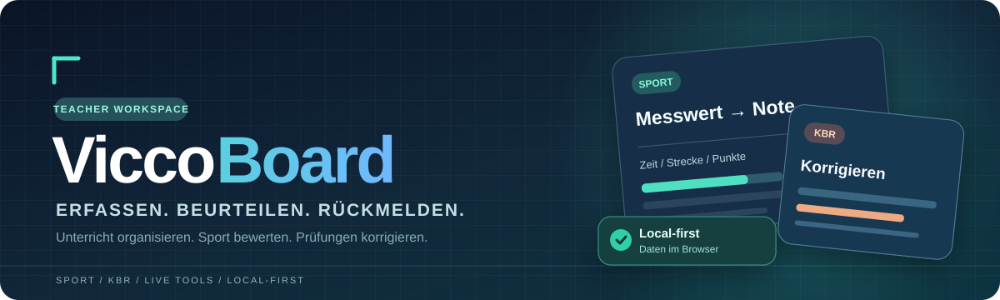

<div align="center">



**One teacher workspace for lessons, PE assessment, and exams.**  
*Local-first. Browser-based. Built for classroom realities.*

[![CI][badge-ci]][ci] [![CodeQL][badge-codeql]][codeql] [![OpenSSF Scorecard][badge-scorecard]][scorecard] [![OpenSSF Best Practices][badge-bestpractices]][bestpractices]  
[![License][badge-license]][license] [![Contributors][badge-contributors]][contributors] [![Last commit][badge-last-commit]][commits] [![Issues][badge-issues]][issues] [![Pull requests][badge-prs]][pulls]  
[![Vue 3][badge-vue]][vue] [![TypeScript][badge-typescript]][typescript] [![Local-first][badge-local]][privacy] [![iPadOS Safari][badge-ipad]][ipad]

[**Explore features**](#features) · [**Get started**](#get-started) · [**Privacy**](#privacy-and-security) · [**Contribute**](#contributing)

[Deutsch](./README.md) · [English](./README.en.md)

</div>

---

> **Less administration. More teaching.** ViccoBoard brings class management, attendance, sports assessments, classroom tools, exam creation, marking, and analysis into one modular web application. Its default workflow stores data **locally in the browser**, without requiring a cloud account or application server.

## Features

| School day | Physical education (Sport) | Exams and correction (KBR) |
| --- | --- | --- |
| Classes, students, lesson planning, schedule and attendance | Timed and measured results, rubric scores, grading tables, PE tests | Exam authoring, marking, grading keys, feedback and analysis |
| Configurable attendance catalogs, absence/injury calendar | Live PE assessment with classroom roster and attendance hints | Compact marking and assessment reports |
| [Students module](./modules/students/) | [Sport module](./modules/sport/) | [Exams module](./modules/exams/) |

### PE: from measurement to grade

Create a **Sportprüfung** by choosing the date, class and discipline. Enter running times, distances, repetitions, counts or rubric scores; see the calculated grade immediately and save a linked assessment session.

- Performance tables, including multidimensional CSV data by grade level, discipline and gender.
- Different grading directions (lower time / higher distance or count).
- Relative performance, such as jump height as a percentage of body height.
- Free observation criteria with 0–3-point or other configured ranges and relative weighting.
- Cooper, shuttle run, middle-distance, sport badge (Sportabzeichen) and federal youth games (Bundesjugendspiele) workflows.
- Class roster with absence hints, participation/passive/missing-kit states and an announced-exam indicator.
- Session-linked performance records, student history and statistics.

**Classroom tools:** timers, multistop, scoreboard, team builder, tournaments, tactics board, dice, feedback, basketball hit tracking, rope-skipping and push-up counters, finish camera, video delay, and slow-motion analysis. Camera-driven tools depend on device capabilities, permissions and real-world conditions. **Automatic handoff from all counters into a Sportprüfung session is not yet fully connected.**

### Student and attendance workflows

ViccoBoard includes class/student records, lesson attendance, configurable status catalogs and a **date-based absence/injury calendar**. IServ absence exports can be imported from ZIP archives with detailed CSV rows, a preview and class/student matching. Imported sums are not treated as independent absences.

### KBR: exams and corrections

The KBR workspace includes simple and structured exam editors, questions and points, grading keys, correction views, result analysis, support-tip libraries and export views. Advanced printing, sharing and integration options may still be incomplete; consult the [product plan](./Plan.md) and [roadmap](./docs/planning/ROADMAP.md).

## Privacy and security

Local-first is a deliberate architectural choice, but **local does not automatically mean encrypted**.

| Present today | Important limitation |
| --- | --- |
| Application data is stored in browser **IndexedDB**. | The current browser database is **not encrypted using an app password**. |
| Browser-based JSON backup export and differential restore. | Backup JSON is **not encrypted** and may contain identifiable student data. Store it securely. |
| Core teacher UI does not require an application server or mandatory cloud account. | Online resources in this GitHub README do not prove that every runtime feature makes zero network requests. |
| Documented security policy, CodeQL and OpenSSF Scorecard workflows. | Automated checks are **not security certifications**. |
| Target: Safari/WebKit and touch-friendly iPad layouts. | Safari may evict local data: verified backup/restore remains essential. |

**App lock, password protection and complete at-rest encryption must not be represented as completed features.** Please review [SECURITY.md](./SECURITY.md) and the [local-first operations runbook](./docs/runbooks/local-first-operations.md) before handling real student records.

## Get started

Requires **Node.js ≥ 20**, **npm ≥ 10** and Git.

```bash
git clone https://github.com/DickHorner/ViccoBoard.git
cd ViccoBoard
npm install
npm run build
npm run dev:ui
```

For the local iPad HTML build:

```bash
npm run build:ipad:local
```

A [manual GitHub Actions workflow](./.github/workflows/daily-driver-build.yml) creates a local iPad artifact. **No stable GitHub Release is published yet.**

## Architecture and quality

```text
apps/teacher-ui/   Vue 3 + TypeScript teacher interface
modules/students/  Student records, imports, absence calendar
modules/sport/     PE grading, sport exams and tools
modules/exams/     Exam building, correction, analysis
packages/core/     Shared interfaces and contracts
packages/storage/  IndexedDB and Node/SQLite adapters
packages/plugins/  Shared plugin building blocks
```

Development respects **`apps → modules → packages`** and module bridges/use cases. The maintainer quality gate is:

```bash
npm run lint:docs
npm run lint:workflows
npm run lint:openssf
npm run typecheck
npm run test
npm run build
```

See the [development guide](./DEVELOPMENT.md), [engineering handbook](./docs/HANDBOOK.md), [documentation index](./INDEX.md), and [changelog](./docs/CHANGELOG.md).

## OpenSSF and trustworthy badges

[CI][ci] and [CodeQL][codeql] report workflow status; [OpenSSF Scorecard][scorecard] assesses supply-chain practices automatically. **[OpenSSF Best Practices project 12057][bestpractices]** is a separate, registered criteria-based process. Its official badge reflects the project's current status; a progress percentage alone is **not** a passing badge. See the [Best Practices playbook](./docs/ossf-badge/PLAYBOOK.md).

## Contributing

Help with real classroom testing, anonymized rubrics, issue reports, accessibility, iPad Safari compatibility, security hardening and small focused patches.

[Contribution guidelines](./CONTRIBUTING.md) · [Issue tracker](https://github.com/DickHorner/ViccoBoard/issues) · [Code of Conduct](./CODE_OF_CONDUCT.md) · [Security disclosure](./SECURITY.md)

## License

[MIT](./LICENSE).

---

<div align="center">

**ViccoBoard — because good teaching should not require a dozen disconnected tools.**

</div>

<!-- Badges -->
[badge-ci]: https://img.shields.io/github/actions/workflow/status/DickHorner/ViccoBoard/ci.yml?branch=main&label=CI
[badge-codeql]: https://img.shields.io/github/actions/workflow/status/DickHorner/ViccoBoard/codeql.yml?branch=main&label=CodeQL
[badge-scorecard]: https://api.securityscorecards.dev/projects/github.com/DickHorner/ViccoBoard/badge
[badge-bestpractices]: https://www.bestpractices.dev/projects/12057/badge
[badge-license]: https://img.shields.io/github/license/DickHorner/ViccoBoard
[badge-contributors]: https://img.shields.io/github/contributors/DickHorner/ViccoBoard
[badge-last-commit]: https://img.shields.io/github/last-commit/DickHorner/ViccoBoard
[badge-issues]: https://img.shields.io/github/issues/DickHorner/ViccoBoard
[badge-prs]: https://img.shields.io/github/issues-pr/DickHorner/ViccoBoard
[badge-vue]: https://img.shields.io/badge/Vue-3-42b883?logo=vuedotjs&logoColor=white
[badge-typescript]: https://img.shields.io/badge/TypeScript-strongly%20typed-3178c6?logo=typescript&logoColor=white
[badge-local]: https://img.shields.io/badge/Data-local--first-008578
[badge-ipad]: https://img.shields.io/badge/Target-iPadOS%20Safari-1d6faa?logo=safari&logoColor=white

<!-- Links -->
[ci]: https://github.com/DickHorner/ViccoBoard/actions/workflows/ci.yml
[codeql]: https://github.com/DickHorner/ViccoBoard/actions/workflows/codeql.yml
[scorecard]: https://scorecard.dev/viewer/?uri=github.com/DickHorner/ViccoBoard
[bestpractices]: https://www.bestpractices.dev/projects/12057
[license]: https://github.com/DickHorner/ViccoBoard/blob/main/LICENSE
[contributors]: https://github.com/DickHorner/ViccoBoard/graphs/contributors
[commits]: https://github.com/DickHorner/ViccoBoard/commits/main
[issues]: https://github.com/DickHorner/ViccoBoard/issues
[pulls]: https://github.com/DickHorner/ViccoBoard/pulls
[vue]: https://vuejs.org/
[typescript]: https://www.typescriptlang.org/
[privacy]: #privacy-and-security
[ipad]: #features
