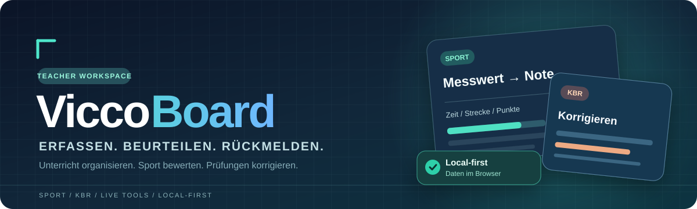

<div align="center">



**Eine Arbeitsoberfläche für Unterricht, Sport und Prüfungen.**  
*Local-first. Browserbasiert. Für den Schulalltag gebaut.*

[![CI][badge-ci]][ci] [![CodeQL][badge-codeql]][codeql] [![OpenSSF Scorecard][badge-scorecard]][scorecard] [![OpenSSF Best Practices][badge-bestpractices]][bestpractices]  
[![License][badge-license]][license] [![Contributors][badge-contributors]][contributors] [![Last commit][badge-last-commit]][commits] [![Issues][badge-issues]][issues] [![Pull requests][badge-prs]][pulls]  
[![Vue 3][badge-vue]][vue] [![TypeScript][badge-typescript]][typescript] [![Local-first][badge-local]][privacy] [![iPadOS Safari][badge-ipad]][ipad]

[**Funktionen entdecken**](#-alles-an-einem-ort) · [**Schnellstart**](#-schnellstart) · [**Datenschutz verstehen**](#-privacy--sicherheit) · [**Mitmachen**](#-mitmachen)

[Deutsch](./README.md) · [English](./README.en.md)

</div>

---

> **Weniger Verwaltung. Mehr Unterricht.** ViccoBoard führt typische Lehrkräfte-Workflows zusammen: Klassen und Anwesenheiten verwalten, Leistungen unmittelbar bewerten, Sport-Tools im Unterricht einsetzen, Prüfungen erstellen, korrigieren und auswerten. Die Standardanwendung arbeitet mit **lokalen Browserdaten** statt mit einem verpflichtenden Cloud-Konto.

## ✨ Alles an einem Ort

| 🏫 **Unterricht organisieren** | 🏃 **Sport bewerten** | 📝 **KBR: Prüfungen & Korrektur** |
| --- | --- | --- |
| Klassen, Schülerprofile, Stunden, Planung, Stundenplan und Anwesenheit | Messwerte, Beobachtungskriterien, Leistungstabellen und sportartspezifische Tests | Aufgabenstruktur, Notenschlüssel, Korrektur, Fördertipps und Auswertungen |
| Statuskataloge und datumsbezogene Abwesenheiten | Live-Sportprüfung mit Klassenauswahl und Notenberechnung | Kompakte Korrekturmaske und Prüfungsanalyse |
| [Schülerverwaltung](./modules/students/) | [Sportmodul](./modules/sport/) | [Prüfungsmodul](./modules/exams/) |

### 🎯 Der Moment, für den ViccoBoard gebaut wird

Du stehst in der Sporthalle. Heute ist Volleyball, morgen ein 100-m-Lauf. Statt zwischen Papierlisten, Stoppuhr, Bewertungsbogen und nachträglicher Notentabelle zu springen, nutzt Du die **Sportprüfung**:

1. **Datum und Klasse** wählen; die Schülerliste wird geladen und vorhandene Abwesenheiten werden berücksichtigt.
2. **Disziplin oder Kriterienbewertung** wählen – etwa „100 m“ oder „Spielfähigkeit Volleyball“.
3. **Zeit, Weite, Treffer oder Beobachtungspunkte** eingeben; die Note wird unmittelbar berechnet.
4. **Prüfungszustände** unterscheiden: Teilnahme, abwesend, passiv/verletzt oder Sportsachen vergessen.
5. **Prüfung speichern** – mit Ergebnissen und einer zugehörigen Sitzung.

Angekündigte Prüfungen können einen **Hinweis auf erforderliches Attest** auslösen. Eine Abwesenheit wird dabei **nicht** in eine erfundene Leistung umgerechnet. Der Schulregel entsprechende Sonderbewertungen, etwa bei vergessenen Sportsachen, müssen im schulischen Kontext geprüft und bewusst verwendet werden.

<details>
<summary><strong>Beispiel: Volleyball mit frei definierten Beobachtungskriterien</strong></summary>

| Beobachtung | Punkteskala |
| --- | ---: |
| Ballflug antizipieren und zum Ball bewegen | 0–3 |
| Sicheres Zuspiel | 0–3 |
| Kommunikation im Spiel | 0–3 |

Die Bewertung verwendet die tatsächlichen Punkte und die konfigurierten Kriteriengewichte. Aus vollständig erfassten Einzelwerten entstehen **Gesamtpunkte, Prozentsatz und Note**. Gewichtung ist relativ (z. B. 1 = normal, 2 = doppelt). Noch nicht beobachtet ist **nicht** dasselbe wie 0 Punkte.

</details>

## 🏃 Sport: Messen, bewerten, handeln

**Bewertung & Leistungserfassung**

- **Kriterienbasierte Bewertung** mit eigenen Beobachtungsmerkmalen, Punkteskalen, relativer Gewichtung und Gesamtbewertung.
- **Messwertbewertung** für Zeiten, Strecken, Höhen, Wiederholungen und Treffer.
- **Bewertungstabellen** importieren und konfigurieren, einschließlich mehrdimensionaler CSV-Tabellen mit Klassenstufen, Disziplinen und Geschlechtszuordnung.
- **Unterschiedliche Bewertungsrichtungen**: bei Zeit gilt oft „weniger ist besser“, bei Strecke oder Anzahl häufig „mehr ist besser“.
- **Relative Bewertung**, beispielsweise Hochsprunghöhe im Verhältnis zur Körpergröße.
- **Sportprüfung im Live-Betrieb** mit Datum, Klassenliste, Anwesenheitshinweisen, Ergebnisseingabe, unmittelbarer Notenberechnung und Speicherung.
- **Test- und Bewertungssysteme** für Cooper-Test, Shuttle-Run, Mittelstrecke, Sportabzeichen und Bundesjugendspiele.
- **Notenübersicht, Leistungshistorie und Sportstatistiken**.

**Live-Tools in der Halle und auf dem Platz**

| Spiel & Organisation | Zeit & Bewegung | Video & Beobachtung |
| --- | --- | --- |
| Scoreboard, Teamzusammenstellung, Turnierplanung, Taktikboard, Würfel | Timer, Multistop, Zielkamera, Liegestützzähler | Video-Delay, Slow-Motion-Analyse |
| Basketball-Treffertracking, Sprungseil-Tracking | Cooper-/Shuttle-Workflows | Bewegungsanalyse mit Markierungen |
| Feedbackmethoden und lokale Spieldatenbank | Leistungsmessung und Auswertung | Kamerabasierte Hilfen, abhängig von Gerät und Berechtigungen |

**Wichtig:** Die Live-Werkzeuge besitzen eigene Oberflächen. Eine automatische Übergabe ihrer Zählergebnisse an eine laufende Sportprüfung ist **noch nicht durchgängig integriert**. Kamerafunktionen hängen von Browser, Berechtigungen, Beleuchtung und praktischer Kalibrierung ab.

**Anwesenheit & Schülerdaten**

- Stundenbezogene Anwesenheit und frei konfigurierbare Statuskataloge.
- Datumsbezogene **Abwesenheiten und Verletzungen** im Schülerkalender.
- **IServ-Abwesenheitsimport aus ZIP-Dateien** mit CSV-Detaildaten, Vorschau, Zuordnung zu Klasse/Schüler und Duplikatsprüfung.
- Schülerverwaltung und Schülerimport; Datenabgleich erfolgt über vorhandene Klassen- und Schülerdatensätze.

## 📝 KBR: von der Prüfungsplanung bis zur Rückmeldung

KBR ist der zweite große Bereich neben Sport. Der Fokus liegt auf einer durchgehenden Arbeitskette:

- **Prüfungen anlegen** – einfache und komplexere Aufgabenstrukturen im Prüfungseditor.
- **Aufgaben, Teilaufgaben, Kriterien und Punkte** verwalten.
- **Notenschlüssel** und Bewertungsvorgaben anwenden.
- **Korrekturen erfassen** – einschließlich kompakter Korrekturansichten und kriterienbezogener Eingabe.
- **Prüfungen analysieren** und Ergebnisse auswerten.
- **Fördertipps verwalten** und für die Rückmeldung nutzen.
- **Prüfungsexporte** über die vorhandenen Export-Ansichten vorbereiten.

Die App enthält bereits diese Workflows. Einzelne erweiterte Druck-, Austausch- und Freigabeszenarien bleiben Bestandteil der [weiteren Roadmap](./docs/planning/ROADMAP.md); die Anwesenheit eines Editors bedeutet nicht automatisch, dass jede in `Plan.md` skizzierte Option produktionsreif ist.

## 🗓️ Der Unterricht drumherum

Auch außerhalb von Prüfungen stellt ViccoBoard passende Arbeitsbereiche bereit: **Dashboard, Stundenplan, Planung, Klassen, Schüler, Anwesenheit, Stunden/Unterrichtsworkspace, Katalogverwaltung und Backups**. So gehören Dokumentation, Leistungsbewertung und organisatorischer Kontext zusammen – ohne dass jeder Bereich eine eigene Schülerliste führen muss.

## 🔐 Privacy & Sicherheit

**Local-first ist eine Architekturentscheidung, kein Marketing-Label.** Für den normalen Betrieb der Teacher-UI sind **kein verpflichtender Cloud-Account und kein laufender Anwendungsserver** erforderlich. Die Web-App ist für statisches Hosting und Browsernutzung konzipiert; Daten werden lokal in **IndexedDB** gehalten.

| Was ViccoBoard derzeit macht | Was das **nicht** bedeutet |
| --- | --- |
| Speichert die Anwendungsdaten lokal im Browser. | Browserdaten sind **nicht automatisch verschlüsselt**. Die aktuelle IndexedDB-Initialisierung nutzt noch keine Passwortverschlüsselung. |
| Ermöglicht JSON-Backups und differenzielle Wiederherstellung lokaler Daten. | Die aktuelle Backup-Datei ist **nicht verschlüsselt**. Sie kann personenbezogene Schülerdaten enthalten und muss entsprechend geschützt werden. |
| Benötigt für die Kernoberfläche keinen eigenen Backend-Server. | Externe Datei-/Badge-Ressourcen im **GitHub-README** sind keine Aussage über Netzwerkanfragen der laufenden App. |
| Trennt UI, Fachmodule und Speicheradapter. | Eine Sicherheitsarchitektur ersetzt keine vollständige Sicherheitsprüfung. |
| Hat eine dokumentierte Sicherheitsrichtlinie, CodeQL- und OpenSSF-Scorecard-Workflows. | Ein grüner Scan ist **keine Zertifizierung** und keine Garantie gegen Sicherheitslücken. |

**Worauf Du besonders achten solltest:** iPadOS/Safari kann lokale Website-Daten unter bestimmten Umständen entfernen. Sichere Deine Daten regelmäßig, bewahre Backups geschützt auf und teste Wiederherstellungen, bevor Du den Browser bereinigst oder Geräte wechselst. **App-Sperre, Passwortschutz und vollständige Verschlüsselung sind noch nicht als fertige Funktionen auszuweisen.**

[Security Policy](./SECURITY.md) · [Backup-/Offline-Runbook](./docs/runbooks/local-first-operations.md) · [Entwicklungsrichtlinien](./DEVELOPMENT.md)

## 📱 iPad-first. Web-first. Unterricht-first.

- **Zielplattform:** iPadOS mit Safari/WebKit und Touchbedienung.
- **Web-App:** Entwicklung mit Vue 3, TypeScript und Vite; keine verpflichtende native App-Installation.
- **Lokalbetrieb:** Browserdatenspeicherung und ein Build für eine lokale iPad-HTML-Datei.
- **Dateifluss:** Import über Dateiauswahl, Export als Download – ohne Abhängigkeit von nicht verfügbaren Safari-Dateisystem-APIs.
- **Responsive Arbeitsflächen** für Unterricht und Korrektur.

Offline-Nutzung und lokale Datei-Builds sind Teil des Projekts; reale Funktionstests auf dem Ziel-iPad bleiben erforderlich, insbesondere nach Browserupdates.

## 🚀 Schnellstart

Voraussetzungen: **Node.js ≥ 20**, **npm ≥ 10**, Git.

```bash
git clone https://github.com/DickHorner/ViccoBoard.git
cd ViccoBoard
npm install
npm run build
npm run dev:ui
```

Für ein lokales iPad-HTML-Artefakt:

```bash
npm run build:ipad:local
```

Das passende manuell startbare GitHub-Workflow heißt [Local iPad Build](./.github/workflows/daily-driver-build.yml). **Eine veröffentlichte stabile Release-Version gibt es aktuell noch nicht.** Die [Release-Pipeline](./.github/workflows/release.yml) ist vorhanden, ersetzt aber keine veröffentlichte Release-Datei.

## 🏗️ Unter der Haube

```text
apps/teacher-ui/      Vue 3, TypeScript, Vite – die Lehrkräfte-Oberfläche
modules/students/     Schüler, Klassenbezug, Import und Kalender
modules/sport/        Sportprüfungen, Bewertung, Werkzeuge und Fachlogik
modules/exams/        Prüfungen, Korrektur und Analyse
packages/core/        Gemeinsame Typen und Schnittstellen
packages/storage/     IndexedDB im Browser, SQLite für Node-/Testpfade
packages/plugins/     Gemeinsame Plugin-Bausteine
```

Die Entwicklungsrichtung ist **`apps → modules → packages`**. Lehrkräfte-Workflows gehören in Fachmodule, statt Geschäftslogik in Vue-Seiten zu duplizieren.

Qualitätschecks:

```bash
npm run lint:docs
npm run lint:workflows
npm run lint:openssf
npm run typecheck
npm run test
npm run build
```

Die Befehle und ihr Umfang sind in [DEVELOPMENT.md](./DEVELOPMENT.md) beschrieben. Maßgebliche Engineering-Regeln: [The 21st Century Coder’s Handbook](./docs/HANDBOOK.md).

## 🛡️ Open Source Security: sichtbar und nachprüfbar

| Signal | Bedeutung |
| --- | --- |
| [CI][ci] | Build, Typecheck, Tests und Repository-Guardrails auf GitHub Actions. |
| [CodeQL][codeql] | Statische Codeanalyse für JavaScript/TypeScript. |
| [OpenSSF Scorecard][scorecard] | Automatisierte Bewertung von Supply-Chain-Praktiken; Zahlen ändern sich. |
| [OpenSSF Best Practices][bestpractices] | Separates, **bereits registriertes Projekt 12057**. Der offizielle Badge zeigt den jeweils erreichten Best-Practices-Status. |
| [Security Policy](./SECURITY.md) | Meldeweg und Reaktionsziele für Schwachstellen. |

**Zwei verschiedene OpenSSF-Verfahren:** **Scorecard** liefert eine automatisierte numerische Projektbewertung; **Best Practices** ist ein kriterienbasierter Projektprozess mit eigenem Status. Ein hoher prozentualer Bearbeitungsstand im Best-Practices-Formular ist **noch kein bestandenes Badge**. Der aktuelle Stand ist auf der jeweiligen Projektseite nachzusehen. [Badge-Playbook](./docs/ossf-badge/PLAYBOOK.md).

## 🧭 Was bereits da ist – und was noch wächst

**Verfügbar im Quellcode:** zentrale Schüler- und Unterrichtsbereiche, Sportbewertung, Prüfungs- und Korrekturoberflächen, zahlreiche Live-Tools, lokale Speicherung und Backups.

**Noch nicht als abgeschlossen bewerben:** durchgängige Anbindung aller Live-Zähler an Sportprüfungssessions, direkte generische XLSX-Mastertabellenverarbeitung, vollständige Verschlüsselung/App-Sperre, alle im Plan vorgesehenen Cloud-/Sharing-Integrationen und ein stabiler Release-Download.

Weiterlesen: [Produktplan](./Plan.md) · [Roadmap](./docs/planning/ROADMAP.md) · [Projektstatus](./docs/status/STATUS.md) · [Changelog](./docs/CHANGELOG.md)

## 🤝 Mitmachen

ViccoBoard ist Open Source. Besonders nützlich sind **Praxistests durch Lehrkräfte**, anonymisierte Beispiel-Bewertungsbögen, reproduzierbare Fehlerberichte, iPad-Safari-Tests, Barrierefreiheitsfeedback und gezielte Codebeiträge.

[Contributing](./CONTRIBUTING.md) · [Issues](https://github.com/DickHorner/ViccoBoard/issues) · [Pull Requests](https://github.com/DickHorner/ViccoBoard/pulls) · [Code of Conduct](./CODE_OF_CONDUCT.md)

Sicherheitslücken bitte **nicht** als öffentliches Issue melden: [SECURITY.md](./SECURITY.md).

## 📄 Lizenz

[MIT License](./LICENSE).

---

<div align="center">

**ViccoBoard — weil gute Unterrichtsarbeit kein Dutzend isolierter Tools braucht.**

<sub>Made for classrooms · Built local-first · Maintained in the open</sub>

</div>

<!-- Badges -->
[badge-ci]: https://img.shields.io/github/actions/workflow/status/DickHorner/ViccoBoard/ci.yml?branch=main&label=CI
[badge-codeql]: https://img.shields.io/github/actions/workflow/status/DickHorner/ViccoBoard/codeql.yml?branch=main&label=CodeQL
[badge-scorecard]: https://api.scorecard.dev/projects/github.com/DickHorner/ViccoBoard/badge
[badge-bestpractices]: https://www.bestpractices.dev/projects/12057/badge
[badge-license]: https://img.shields.io/github/license/DickHorner/ViccoBoard
[badge-contributors]: https://img.shields.io/github/contributors/DickHorner/ViccoBoard
[badge-last-commit]: https://img.shields.io/github/last-commit/DickHorner/ViccoBoard
[badge-issues]: https://img.shields.io/github/issues/DickHorner/ViccoBoard
[badge-prs]: https://img.shields.io/github/issues-pr/DickHorner/ViccoBoard
[badge-vue]: https://img.shields.io/badge/Vue-3-42b883?logo=vuedotjs&logoColor=white
[badge-typescript]: https://img.shields.io/badge/TypeScript-strongly%20typed-3178c6?logo=typescript&logoColor=white
[badge-local]: https://img.shields.io/badge/Data-local--first-008578
[badge-ipad]: https://img.shields.io/badge/Target-iPadOS%20Safari-1d6faa?logo=safari&logoColor=white

<!-- Links -->
[ci]: https://github.com/DickHorner/ViccoBoard/actions/workflows/ci.yml
[codeql]: https://github.com/DickHorner/ViccoBoard/actions/workflows/codeql.yml
[scorecard]: https://scorecard.dev/viewer/?uri=github.com/DickHorner/ViccoBoard
[bestpractices]: https://www.bestpractices.dev/projects/12057
[license]: https://github.com/DickHorner/ViccoBoard/blob/main/LICENSE
[contributors]: https://github.com/DickHorner/ViccoBoard/graphs/contributors
[commits]: https://github.com/DickHorner/ViccoBoard/commits/main
[issues]: https://github.com/DickHorner/ViccoBoard/issues
[pulls]: https://github.com/DickHorner/ViccoBoard/pulls
[vue]: https://vuejs.org/
[typescript]: https://www.typescriptlang.org/
[privacy]: #privacy--sicherheit
[ipad]: #ipad-first-web-first-unterricht-first
